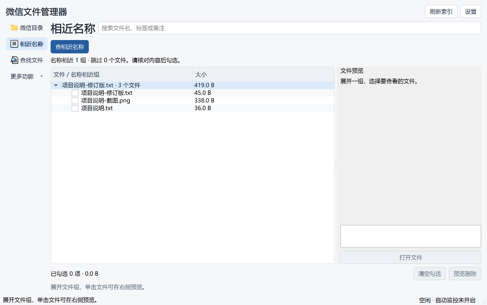

# WeChat-File-Manager
A modern, local-first WeChat file manager for Windows.

---

# 微信文件管理器 1.4.0（持续开发中）

Windows 本地桌面文件管理器。主界面提供微信目录、相近名称和查找文件三个入口。目录别名、备注、标签和清理记录保存在本地 SQLite。

Windows 11 已完成本机验证。Windows 10 **待验证**。

## 目录浏览与清理

- 左侧可切换“中文分类视图”和“真实目录视图”。中文分类是虚拟结构，不创建、移动或重命名实际文件夹。用途按账号下的相对路径识别，未知目录保留原名称并显示“用途尚未确认”；别名不会改变删除权限。
- 选择具体目录后，右侧展示中文名、原名、用途、完整路径、元数据数量/大小、最近成功扫描时间、当前完整性及备注，可打开实际目录或复制路径。双击目录或点击详情按钮设置名称和备注；文件详情可跳转到对应的真实目录。
- 普通文件列表右键“移入回收站（仅所选文件）”。先后台预检查，再显示确认清单、容量、账号及禁用原因；必须确认清单并额外确认微信原始附件风险。执行前重新检查大小、纳秒时间、身份、路径与占用状态。
- 「相近名称」按普通文件的名称前缀及副本、修订版等后缀分组，支持跨扩展名。展开后点击文件即可在侧栏核对完整路径，预览图片、PDF 首页及常见文本，其他格式可用系统程序打开。
- 复选框只在可处理的普通文件旁显示。点「预览删除」核对全局勾选，确认原始附件路径风险后移入 Windows 回收站。名称相近可能代表不同版本，请在清理前核对内容。
- 删除只调用 Windows Shell 的回收站接口，不提供永久删除或失败回退。成功后标记索引缺失并使哈希缓存失效，保留个人备注。结果逐项反馈，设置中可查看本机删除记录或打开 Windows 回收站；不会把回收站接收容量当成已释放空间。

本轮只允许索引中、已确认存储角色下的普通格式文件：新版 `msg/file`、`msg/video`，旧版 `FileStorage/File`、`FileStorage/Image`、`FileStorage/Video`。数据库、配置、缓存、`msg/attach`、未知目录、加密/专有格式、目录本身、隐藏/系统文件及任何链接或重解析点均禁止。当前仅确认本地固定 NTFS 磁盘，网络、设备、移动盘及其他文件系统拒绝删除。

清理建议只覆盖索引内可验证的普通附件。导出副本和外部归档仍可通过资源管理器管理。索引发现变动、访问异常或完成清理后，请重新检测以更新清单。本机记录用于核对，文件恢复通过 Windows 回收站操作。

## V1.2 智能管理

- **增量更新**：完整扫描仍需遍历目录，但未变化文件不会重复写入文件表；取消会回滚当前账号未完成的索引提交。无法访问的文件或目录保留旧状态与备注。
- **自动监控**：默认关闭，在“设置与备份 → 开启/关闭自动监控”开启。使用 Windows 原生 watchdog 事件，默认防抖 0.6 秒、最长合并窗口 2 秒；启动/重启、目录变化或队列积压时全量校正，并每 15 分钟再次校正。监控异常可选择“重新启动自动监控”，或手动刷新；监控开关随本地备份保存。
- **批量管理**：文件列表右键支持对所选文件或全部当前筛选结果添加/移除指定标签、收藏/取消收藏。操作前显示预计数量，完成后显示实际成功、变更和失败数量；只操作本程序的元数据。
- **存储统计**：独立界面展示分类容量占比、账号对比、大文件前 100、主要目录分布和历史索引中的重复容量。数据标注扫描时间与未完成状态。

理论冗余容量与实际可释放空间分别统计，实际占用还受硬链接、压缩和回收站影响。哈希及删除记录保存在本机。

## 运行

自行构建后，在输出目录中双击 `WeChatFileManager.exe`。必须保留旁边的 `_internal` 文件夹；可以把整个目录移动到任意普通文件夹。无需安装 Python。

源码运行：Python 3.11+，创建 `.venv`，执行 `pip install -r requirements.txt`，然后 `python run.py`。构建执行 `build.bat`。

## 使用

1. 启动会探测常见目录；未找到时点“添加微信目录”，选择 `D:\xwechat_files` 或具体账号目录。
2. 刷新索引在后台扫描，启动时会更新索引。文件内容不会写入索引，不计算扫描文件的内容哈希。
3. 在“微信目录”浏览账号与目录，按需切换中文/真实视图并展开详情。双击实际目录可设置名称和备注。
4. “查找文件”支持文件名、扩展名、标签及备注。日期、大小和标签条件位于“高级筛选”，日期按文件修改时间计算。点击列标题排序。
5. 选中文件后展开“详情”，填写标签、备注及收藏并点“保存备注”。切换文件、刷新或关闭前若有修改，会提示保存、放弃或取消。标签用逗号分隔。
6. 图片在右侧预览；文档调用系统程序。加密附件和数据库不会解析；内部文件在原始树的数量、大小统计中体现，不进入普通文件列表。
7. Ctrl / Shift 多选后，从右键菜单选择“复制 / 导出所选”。复制会校验 SHA-256 并生成 UTF-8 CSV 清单。请选择微信原始目录以外的目标。
8. “设置与备份”支持备份及恢复完整索引、账号设置、目录别名、备注、标签和收藏。恢复会校验备份并自动保存现有数据到数据目录的 `backups` 子目录，通过 SQLite API 处理 WAL，无需手动替换数据库文件。默认数据位置为 `%LOCALAPPDATA%\WeChatFileManager\index.sqlite`。
9. “更多功能”包含标签管理、收藏、统计、自动监控、设置与备份及删除记录。列表右键支持批量添加或移除标签和收藏，范围可选所选文件或全部筛选结果。
10. 列表每批 200 条，滚动时按需加载。点击列标题在全部匹配结果中排序。原始目录展开时加载，超过 200 个子目录可双击“加载更多目录”。目录悬停可查看原路径和占用。
11. 日期筛选勾选后通过日历选择；图片解码在后台进行。Windows 中“打开所在文件夹”会尽量选中对应文件。

## 范围与限制

- 支持含 `msg` 的新版账号和含 `FileStorage` 的旧版账号；允许添加多个账号，文件夹联接和符号链接跳过。
- 内部缓存和数据库只读取文件属性用于统计。不解密 `.dat`，不自动识别联系人/群名，不搜索文档正文。
- 刷新保留同一路径且文件身份一致的备注；外部移动/重命名作为新文件，旧路径显示在“已不存在的文件”。不会猜测匹配备注。
- 扫描账号发生读取错误时，保留其旧文件存在状态，避免将未读取到的文件误标为删除。统计可能不完整，界面会提示。
- 扫描与监控校正采用单账号索引事务，数据库提交期间可能短暂等待。监控不保证永久无遗漏，手动完整扫描始终保留。
- 预览限制 40 MiB、6000 万像素，超限使用系统程序打开。内部附件、缓存不进入普通文件表。
- 不提供目录删除、永久删除、自动清理、微信目录重命名或移动。导出副本会额外占用空间；移入回收站通常不立即释放空间。
- V1.0（schema 0）、V1.1（schema 3）、V1.2（schema 4）自动迁移到 schema 5，升级前自动备份到数据目录的 `backups` 子目录，保留原有个人信息；高版本数据库和损坏备份会拒绝打开或恢复。恢复备份会替换当时的索引及本机记录，恢复前自动备份保留当前记录以便核对。
- 大规模外部变动期间分页结果可能变化；手动刷新可重新查询。自动更新遇到未保存编辑时不会强制刷新或丢弃编辑。
- 普通扫描和事件监控只处理元数据；内部数据库/缓存只统计属性，不解析、不哈希。内部目录容量以最近完整扫描为准，监控不持续更新其文件内容。
- 哈希缓存基于可用文件属性进行失效判断，并非文件防篡改机制；结果表示最近一次稳定校验时的状态。

## 测试与性能

执行 `python -m pytest -q`。原生 Windows 11 界面自检使用新的空数据目录：设置 `WFM_DATA_DIR`，执行 `python run.py --self-test`。该自检不调用实际删除。回收站原生探针需显式执行 `python -m tools.recycle_probe --run-native`，只处理脚本在项目 `.tmp` 内新建的一份模拟文本；保留对照文件，不操作真实微信目录。默认测试用夹具内模拟隔离区验证删除业务，并单独测试 Shell 的非回收站否决、成功回执和取消。

V1.4 的布局、跨页清理与回归结果见 [V1.4 测试报告](docs/V1.4测试报告.md)。V1.2 的扫描对比、哈希缓存和监控延迟见 [性能数据](docs/V1.2性能测试.json)。

GitHub Actions 对 Windows Server 2022/2025 执行自动化测试和原生界面自检，不自动打包、不上传安装包，也不代表 Windows 10 实机验证。

## 开源说明

基于 oracis/wechat-file-organizer-gui（MIT）目录识别、扩展名分类及月份判定思路，重写 PySide6 界面和 SQLite 服务。月份判定含改编代码，来源提交 d107d282efdbf7d56fc0d424d541f128c534c037。版权声明见 licenses。PySide6/Qt 以动态库分发，适用 LGPLv3 或其他对应许可，许可文本随运行库和 licenses 目录提供；本项目不链接专有 Qt 模块。

文件事件监控使用 [watchdog](https://github.com/gorakhargosh/watchdog)，Apache-2.0，许可文本见 `licenses/watchdog-LICENSE.txt`。未增加大型可视化依赖。

Windows Shell 通过 [pywin32](https://github.com/mhammond/pywin32) 调用。回收站适配依据 [IFileOperation 标志](https://learn.microsoft.com/en-us/windows/win32/api/shobjidl_core/nf-shobjidl_core-ifileoperation-setoperationflags) 和 [PostDeleteItem 回执](https://learn.microsoft.com/en-us/windows/win32/api/shobjidl_core/nf-shobjidl_core-ifileoperationprogresssink-postdeleteitem)，启用回收标志并在删除前回调否决非回收方式，要求成功状态和回收站新条目回执；不使用旧式删除接口。

## 源码发布说明

本仓库仅提供源码和必要文档，不包含预编译 EXE、微信数据或本地索引。构建入口为 `build.bat` / `package.spec`；`WeChatFileManager.spec` 为早期调试配置，保留作参考。

界面预览使用虚构账号和示例文件：

